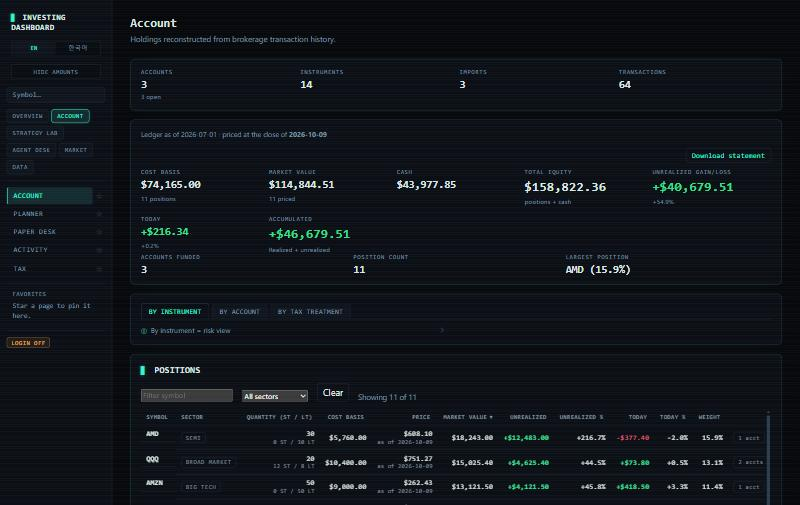
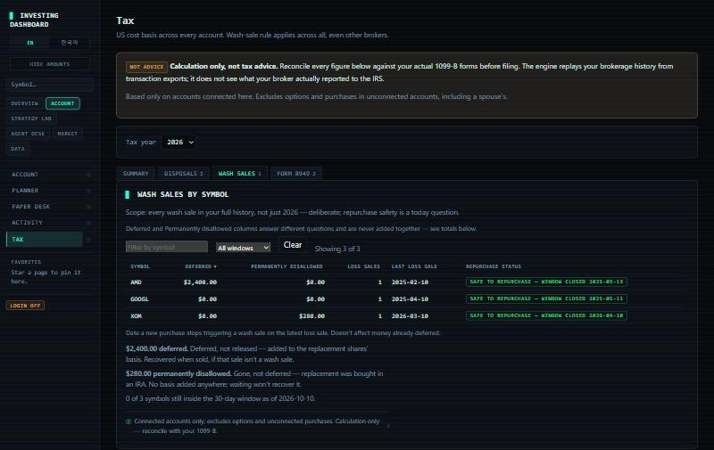
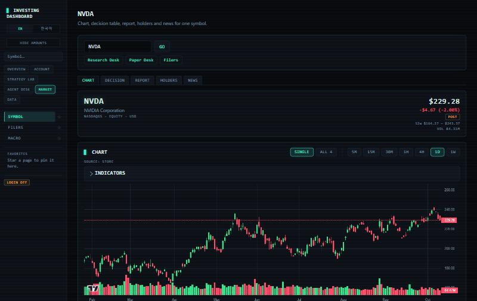
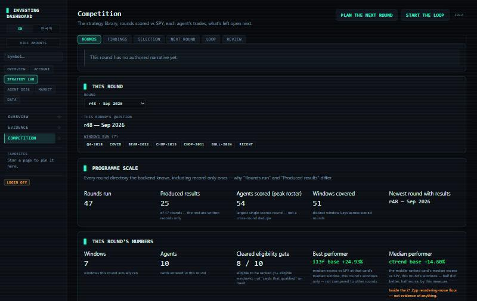
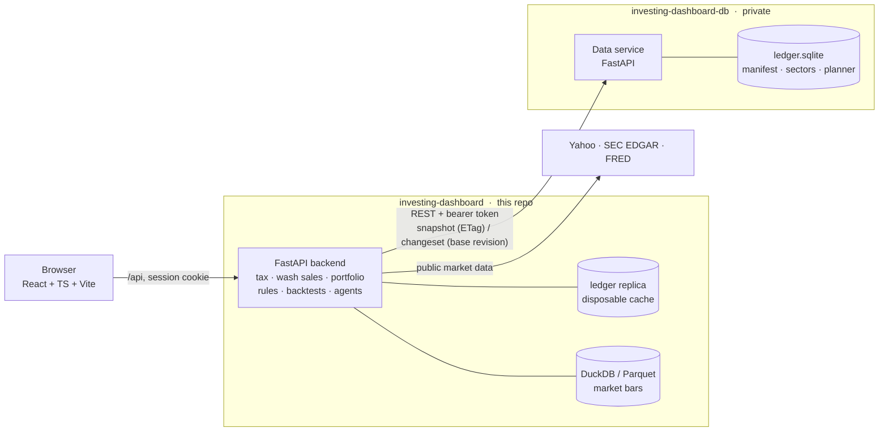

# Quantitative Finance Analytics Platform

A full-stack investing workstation. It takes raw brokerage exports and produces an auditable US
tax picture, live account views and a research lab. Every number traces back to the source row
that produced it.

> **Status: public beta.** The demo runs on an invented portfolio. Personal data lives in a
> separate service, [`investing-dashboard-db`](#architecture), and is never part of this
> repository.

| Account | Tax · wash sales |
|---|---|
|  |  |
| **Symbol research** | **Strategy Lab · competition** |
|  |  |

<sub>Screenshots are from demo mode: an invented portfolio priced at live market data.</sub>

## Highlights

| Area | What it does |
|---|---|
| **Ledger ingestion** | Normalises Robinhood, Webull and SoFi exports into one canonical, append-only ledger. Provenance goes down to the source CSV row. Trades replay in true chronological order, even though brokers export newest-first. Re-imports are idempotent, and restated figures are flagged as conflicts, never silently overwritten. |
| **US tax engine** | Lot-level cost basis, short/long-term gains and IRS Form 8949 output. Cross-account **wash-sale detection**: deferred vs. permanently disallowed (IRA replacements, Rev. Rul. 2008-5), basis carried into replacement lots, and repurchase-safe dates. Decimal arithmetic end to end. |
| **Account views** | Holdings, cash roll-forward, allocation by sector and ticker, realized/unrealized P&L, open/closed accounts. A drag-and-drop **Planner** that is wash-sale aware. |
| **Strategy Lab** | A rule DSL plus a backtest workbench with lookahead guards and multiple-testing correction (Benjamini–Hochberg). Includes a round-based tournament and an evolution loop that proposes, tests and promotes strategy cards, with every decision recorded. |
| **Paper Desk** | Reference strategies trade forward on paper so their live records can be compared against their backtests. |
| **Agent Desk** | Claude-powered research desks: a multi-role Trading Agents pipeline (analysts → bull/bear debate → trader → risk → PM), a DAG-scheduled Vibe Trading desk, and a Manager desk that writes a grounded daily brief. A **grounding gate** rejects model output that cites numbers not present in the evidence. |
| **Market & filings** | Charts at 5m–1w with indicator overlays, 13F/N-PORT holdings straight from SEC EDGAR (share changes kept separate from value changes), filer consensus, and a macro panel (rates, curve, oil, volatility, sentiment). |
| **Personas** | Turns public YouTube commentary into dated, cited notes per creator, with a bilingual retriever and chat. |
| **i18n** | English and Korean throughout. The TypeScript compiler fails the build if a translation key is missing. |

Nothing here is investment or tax advice. The tax module shows its work so it can be reconciled
against a 1099-B; the lab reports what conditions did historically, with sample sizes and
significance.

## Architecture



- **Personal data has one home.** The dashboard backend doesn't persist the ledger, the account
  manifest, sector labels or the Planner board. It gets them through `app.datasource`, which has
  three modes:
  - `demo` seeds an invented portfolio, so a fresh clone works out of the box;
  - `local` reads plain files, for tests and offline use;
  - `remote` uses the data service.
- **Reads are on demand and cached by revision.** The backend checks the service's ledger revision
  at most every couple of seconds. It pulls a snapshot only when the revision has moved, and
  materialises it into a replica file per revision, so a reader mid-query never sees a half-written
  ledger.
- **Writes are a single atomic changeset.** An import runs the normal ingest pipeline against a
  private copy of the replica. The difference is sent as one changeset naming its base revision,
  using optimistic concurrency: the service applies all of it, or none of it if the base is stale.
- **Nothing derived is stored.** Lots, positions, wash-sale adjustments and gains are recomputed
  from the ledger on every request. A cached tax figure can't drift from the ledger beneath it.

See [docs/ARCHITECTURE.md](docs/ARCHITECTURE.md) for the module map and data flow.

## Quick start (demo data)

**Docker**

```bash
cp .env.example .env                       # defaults to INVDASH_DATA_SOURCE=demo
API_PROXY_TARGET=http://backend:8000 docker compose --profile backend up --build -d
docker compose exec backend python -m app.auth.cli add-user demo   # the app requires a login
# http://localhost:8080
```

**Local**

```bash
python -m venv .venv
.venv/Scripts/pip install -r backend/requirements-dev.lock.txt && .venv/Scripts/pip install -e backend --no-deps
cp .env.example .env
.venv/Scripts/python -m app.auth.cli add-user demo        # the app requires a login
cd backend && ../.venv/Scripts/uvicorn app.main:app --port 8000
cd frontend && npm ci && npm run dev                      # http://localhost:5173
```

(On macOS/Linux use `.venv/bin/` instead of `.venv/Scripts/`.)

### Using your own data

1. Run [`investing-dashboard-db`](https://github.com/LazySiru-AI/investing-dashboard-db) and
   generate a token.
2. In `.env`, set `INVDASH_DATA_SOURCE=remote`, `INVDASH_DB_SERVICE_URL` and
   `INVDASH_DB_SERVICE_TOKEN`.
3. Drop broker CSV exports into the import inbox (`data/`, which is gitignored), declare the
   accounts on **Data › Imports**, and import. The rows go to the data service, not to this
   checkout.

## Configuration

Every setting is an environment variable with the `INVDASH_` prefix, read by
`backend/app/config.py`. [`.env.example`](.env.example) documents each one. The main ones:

| Variable | Default | Purpose |
|---|---|---|
| `INVDASH_DATA_SOURCE` | `demo` (in `.env.example`) | `demo` · `local` · `remote` |
| `INVDASH_DB_SERVICE_URL` / `_TOKEN` | — | Data service location and bearer token (remote mode) |
| `INVDASH_AUTH_ENABLED` | `1` | Login gate; turn off only for loopback-only development |
| `INVDASH_AUTH_COOKIE_SECURE` | `0` | Set to `1` behind TLS |
| `INVDASH_CONTACT_EMAIL` | placeholder | Required by SEC EDGAR's fair-access policy |
| `ANTHROPIC_API_KEY` | — | Optional; enables the Agent Desk. Spend is capped per call and per day |

## Security

- **Authentication.** Login is required by default (scrypt password hashes, server-side
  sessions, per-user and per-IP throttling). Roles are owner and member. Account, tax and
  manager routes are owner-only. Model-spending and long-running write routes need the owner.
- **Data minimisation.** Personal data stays in the data service, behind a bearer token, bound to
  loopback, and never exposed to the browser. The dashboard keeps only a disposable replica in
  its gitignored cache.
- **Headers and inputs.** Security headers are on every response. Path parameters are validated
  against traversal. Request size limits apply. Model output passes a grounding gate before it's
  shown.
- **Supply chain.** Lockfiles are hash-pinned. CI runs `pip-audit`, `npm audit`, detect-secrets
  and a PII scanner.

See [SECURITY.md](SECURITY.md) for reporting.

## Testing

```bash
.venv/Scripts/python -m pytest                   # backend (~7,000 tests)
cd backend && ../.venv/Scripts/python -m mypy app
.venv/Scripts/python -m ruff check backend tests
cd frontend && npx tsc --noEmit && npx vitest run   # frontend (~2,000 tests)
```

Tax figures are pinned against a frozen synthetic ledger (`tests/fixtures/synthetic_ledger.py`) of
invented securities. It reproduces the defect shapes found during development: newest-first
exports, cross-broker instrument identity, wash-sale disallowance split across replacement lots,
IRA replacements, and sub-cent rounding.

## Stack

Python 3.12 · FastAPI · Pydantic · SQLite · DuckDB/Parquet · React 18 · TypeScript · Vite ·
Vitest · TradingView lightweight-charts · Anthropic API · Docker · GitHub Actions

## Repository layout

```
backend/app/
  datasource/   the one door to personal data (demo · local · remote)
  ingest/       broker adapters, manifest, idempotent import
  core/ tax/    canonical ledger, lots, wash sales, Form 8949
  market/       providers, bars store, freshness, sectors
  rules/ backtest/ tournament/ evolution/ paperdesk/   strategy lab
  agents/ tradingagents/ vibedesk/ workflow/ manager/ personas/   agent desk
  auth/         login, sessions, role gate, security headers
frontend/src/   pages, components, typed API clients, i18n
tests/          backend tests and synthetic fixtures
strategy-program/, data/rounds/   research protocol and the record of every round run
docs/           design docs, contracts, runbooks
```

## License

[MIT](LICENSE)
